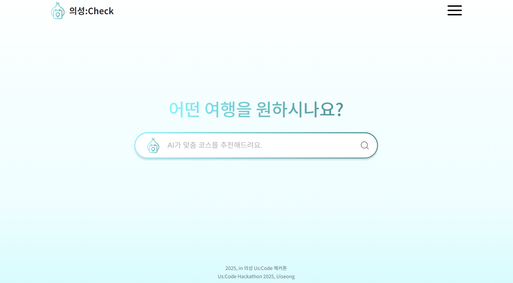
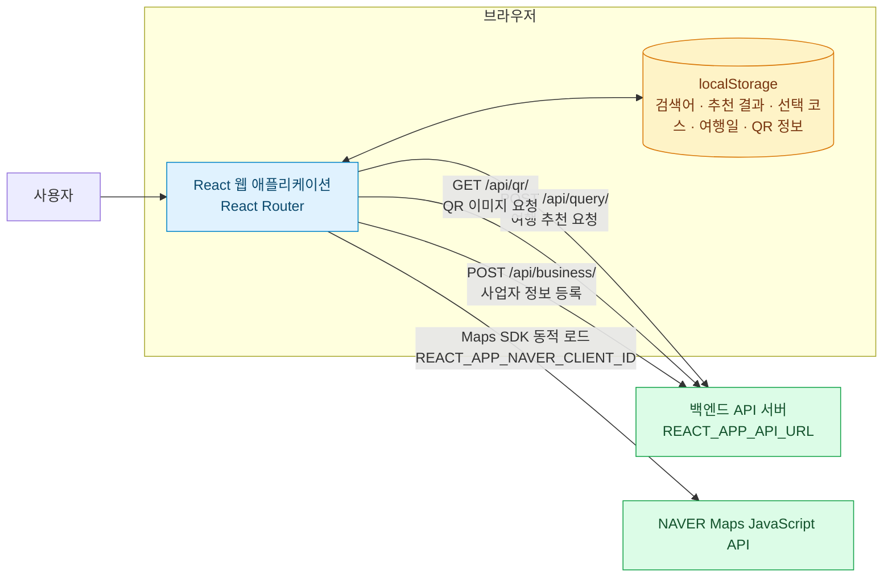

<!-- 대표 화면과 데모 영상: GitHub에서 재생 가능한 링크형 임베드 -->
<a href="https://www.youtube.com/watch?v=EjaPMB0wIrY" target="_blank" rel="noopener noreferrer">
  
</a>

<p align="center">
  <a href="https://www.youtube.com/watch?v=EjaPMB0wIrY" target="_blank" rel="noopener noreferrer">▶ YouTube 데모 영상 보기</a>
</p>

<p align="center">
  프로젝트가 해결한 지역 문제와 해결 과정, YouTube 데모는
  <a href="https://us-check.github.io/" target="_blank" rel="noopener noreferrer"><strong>배포 페이지</strong></a>에서 확인할 수 있습니다.
</p>

# us-check Client

> AI 추천과 파친코 방식의 선택 경험을 결합한 의성군 여행 코스 탐색 웹 애플리케이션입니다.

여행 취향을 자연어로 입력하면 추천 결과를 바탕으로 관광지·음식점·숙박시설을 골라 여행 코스를 구성합니다. 선택한 코스는 지도에서 확인하고, 여행일과 QR 확인 화면까지 이어서 관리할 수 있습니다.

## ✨ 주요 기능

| 기능 | 설명 |
| --- | --- |
| AI 여행 코스 요청 | 사용자가 입력한 여행 취향을 API로 전송해 추천 장소 데이터를 받아옵니다. |
| 파친코식 코스 선택 | 관광지, 음식점, 숙박시설별 후보를 슬롯 방식으로 추천하거나 직접 선택합니다. |
| 지도 기반 코스 확인 | 선택한 장소를 네이버 지도 마커로 표시하고, 장소별 상세 위치를 확인합니다. |
| 여행일·인원·금액 설정 | 여행일을 지정하고 음식점·숙박시설의 수량을 조정해 총 금액을 확인합니다. |
| QR 예약 확인 | 완료 화면에서 QR 코드를 확인하고 선택한 코스와 여행 정보를 다시 볼 수 있습니다. |
| 사업자 정보 등록 | 가게 정보와 이미지를 입력해 사업자 등록 API로 전송합니다. |

## 🧭 설계 방향

- **카테고리 기반 코스 구성:** API 추천 결과를 관광지·음식점·숙박시설로 분류해 각 카테고리에서 한 곳씩 선택합니다.
- **브라우저 상태 전달:** 검색어, 추천 결과, 선택 코스, 여행일, QR 정보를 `localStorage`에 저장해 화면 전환 사이에서 사용합니다.
- **환경변수로 외부 서비스 연결:** 백엔드 API 기본 URL과 네이버 지도 클라이언트 ID를 `REACT_APP_` 환경변수로 분리합니다.

## 🛠 기술 스택

| Category | 기술 |
| --- | --- |
| Frontend | React 18.3.1, React DOM 18.3.1 |
| Routing | React Router DOM 6.30.1 |
| UI & Motion | styled-components 6.1.19, Framer Motion 12.19.2, React Icons 5.5.0 |
| Map & Date | NAVER Maps JavaScript API, React Datepicker 8.4.0 |
| Networking & State | Fetch API, Axios 1.10.0, Web Storage (`localStorage`) |
| Testing & Build | React Scripts 5.0.1, Testing Library |

## 🏗️ 시스템 아키텍처



클라이언트는 화면 전환에 필요한 상태를 브라우저에 보관하고, 추천·QR·사업자 등록 요청만 `REACT_APP_API_URL`의 API 서버로 전송합니다. 지도 SDK는 네이버 지도 API에서 브라우저로 직접 불러옵니다.

## 📁 프로젝트 구조

```text
client/
├── public/                 # 정적 이미지와 HTML 템플릿
├── src/
│   ├── components/         # 재사용 UI 컴포넌트
│   ├── pages/              # 화면별 페이지와 지도·QR 컴포넌트
│   ├── styles/             # styled-components 스타일 정의
│   ├── App.js              # 라우팅 구성
│   └── index.js            # 애플리케이션 진입점
├── package.json            # 의존성 및 실행 스크립트
└── README.md
```

## 🚀 시작하기

### 요구 사항

- Node.js와 npm
- 네이버 클라우드 플랫폼 Maps API에서 발급한 클라이언트 ID
- AI 추천, QR 생성, 사업자 등록 기능에 연결할 백엔드 API 서버

### 1. 프로젝트 디렉터리로 이동

저장소 루트에서 다음 명령을 실행합니다.

```bash
cd client
```

### 2. 설정하기

의존성을 설치한 뒤 `client/.env` 파일을 만들고, 실제 서비스 값을 설정합니다. 환경변수 값은 저장소에 커밋하지 않습니다.

```bash
npm install
```

```env
REACT_APP_API_URL=<API 서버 기본 URL>
REACT_APP_NAVER_CLIENT_ID=<네이버 지도 클라이언트 ID>
```

`REACT_APP_API_URL`은 다음 엔드포인트를 제공하는 서버를 가리켜야 합니다.

```text
POST /api/query/
GET  /api/qr/
POST /api/business/
```

### 3. 실행하기

```bash
npm start
```

개발 서버가 실행되면 [http://localhost:3000](http://localhost:3000)에서 확인할 수 있습니다.

### 4. 검증하기

```bash
CI=true npm test -- --watchAll=false
npm run build
```
